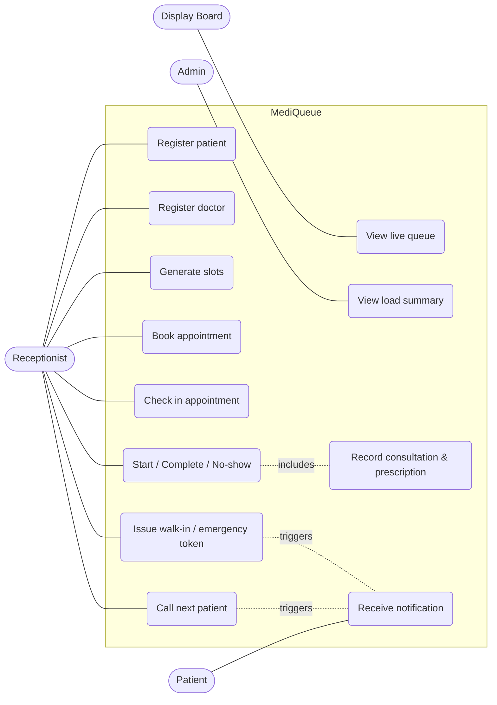
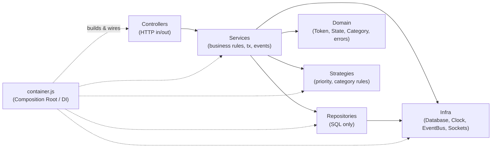
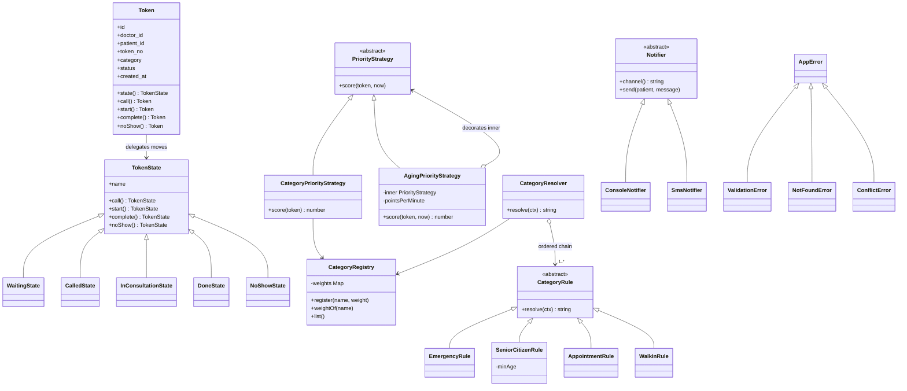
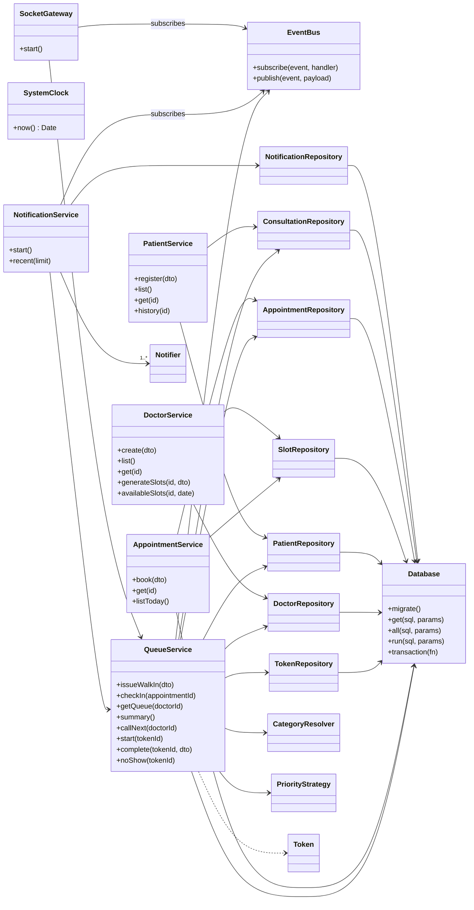
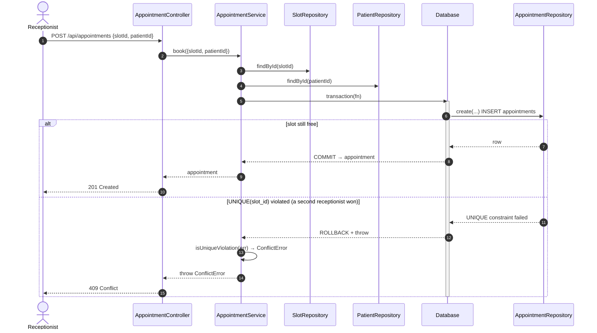
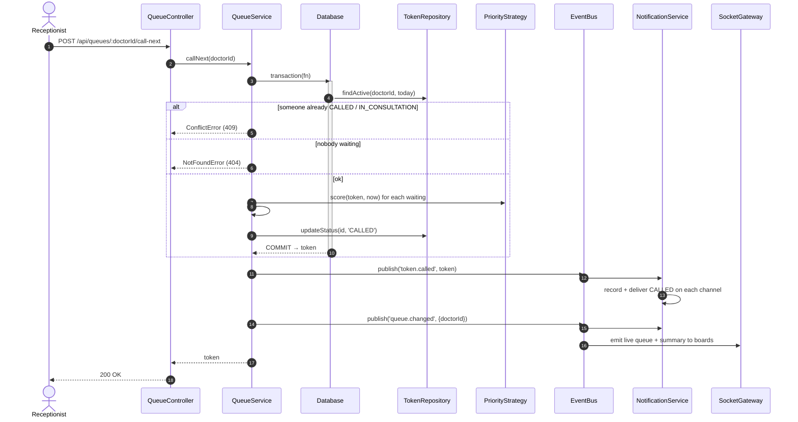
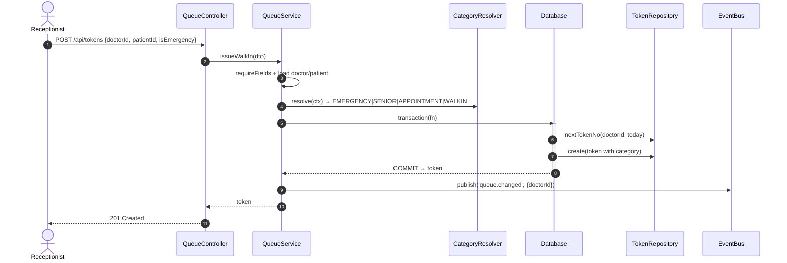
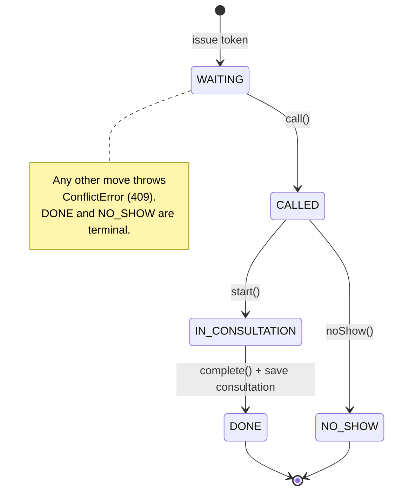
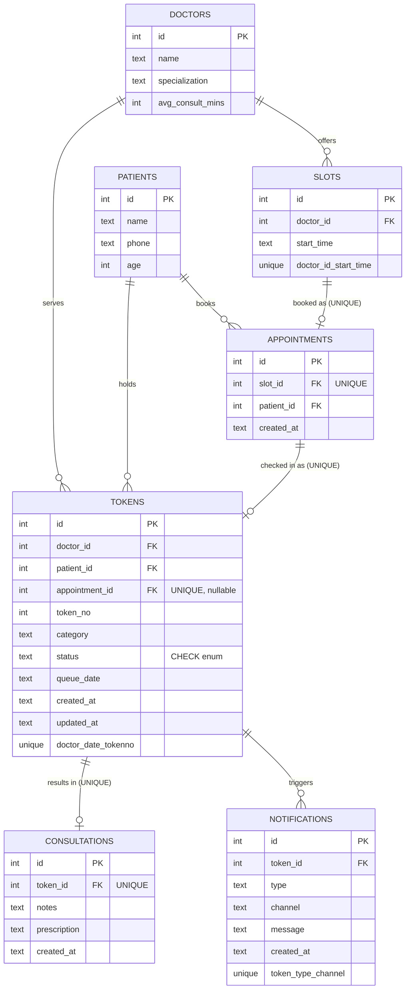

# MediQueue — Low-Level Design (LLD)

Formal System-Design document for the capstone evaluation. It is organised **one section per evaluation criterion**. Every claim points at the file that proves it, so the design and the code can be checked against each other.

> Companion docs: **[README.md](README.md)** (run + API cheat-sheet) · **[DESIGN.md](DESIGN.md)** (viva prep: requirement → concept → code, trade-offs, likely questions).
>
> All diagrams are [Mermaid](https://mermaid.js.org/) and render on GitHub and in VS Code (Markdown preview). For a slideshow, paste any block into <https://mermaid.live>.

**Contents**
1. [Requirement Analysis](#1-requirement-analysis)
2. [Class Diagram](#2-class-diagram)
3. [Object-Oriented Design](#3-object-oriented-design)
4. [SOLID Principles](#4-solid-principles)
5. [Design Patterns](#5-design-patterns)
6. [Sequence & Activity Diagrams](#6-sequence--activity-diagrams)
7. [API / Interface Design](#7-api--interface-design)
8. [Database Schema](#8-database-schema)
9. [Error Handling, Validation & Edge Cases](#9-error-handling-validation--edge-cases)
10. [Working Implementation](#10-working-implementation)

---

## 1. Requirement Analysis

### 1.1 Problem statement
A hospital needs to manage **doctor schedules, appointment booking, and a live walk-in queue** per doctor, serving patients in a fair priority order (emergencies and seniors first) while never letting an ordinary patient starve. Multiple receptionists work at once, and public display boards must update in real time. Nothing may be lost if the server crashes.

### 1.2 Actors

| Actor | Description | Primary goals |
|---|---|---|
| **Receptionist** (primary) | Front-desk staff operating the reception console | Register patients, book appointments, check patients in, drive the queue (call next / start / complete / no-show) |
| **Admin** | Operations/manager | See queue load across all doctors |
| **Display Board** | Read-only screen in the waiting area | Show the live queue for one doctor; auto-refresh |
| **Patient** | Person being treated | Be notified when their turn is near / called (receives notifications; does not operate the system) |
| **Doctor** | Consulting physician | Owns a schedule and consults the called patient (modelled as data + avg consult time; not a system operator) |
| **Notifier (external system)** | Console / SMS / (future WhatsApp) channel | Deliver "turn near" and "called" messages |

### 1.3 Functional requirements

| ID | Requirement | Realised in |
|---|---|---|
| FR-1 | Register doctors with a specialization and average consult time | `DoctorService.create` |
| FR-2 | Generate back-to-back bookable slots for a doctor on a date (idempotent) | `DoctorService.generateSlots` |
| FR-3 | Register patients (name, phone, age) | `PatientService.register` |
| FR-4 | Book an appointment against a free slot | `AppointmentService.book` |
| FR-5 | **No double-booking** even with concurrent receptionists | `UNIQUE(slot_id)` + `AppointmentService.book` |
| FR-6 | Issue a walk-in / emergency token | `QueueService.issueWalkIn` |
| FR-7 | Check an appointment in → issue a token (once only) | `QueueService.checkIn` |
| FR-8 | Order the queue: Emergency > Senior > Appointment > Walk-in | `CategoryPriorityStrategy` + `CategoryResolver` |
| FR-9 | Prevent starvation (aging) | `AgingPriorityStrategy` |
| FR-10 | Token lifecycle: Waiting → Called → In-Consultation → Done / No-Show, rejecting illegal jumps | `Token` + `TokenState` |
| FR-11 | One patient with the doctor at a time | `QueueService.callNext` guard |
| FR-12 | Estimate each waiting patient's wait time | `QueueService.getQueue` |
| FR-13 | Notify patients as their turn nears / when called, at most once per channel | `NotificationService` + `UNIQUE(token,type,channel)` |
| FR-14 | Real-time display boards per doctor + admin summary | `SocketGateway` |
| FR-15 | Record consultation notes & prescription; expose patient history | `ConsultationRepository`, `PatientService.history` |
| FR-16 | Admin load summary across doctors | `QueueService.summary` |

### 1.4 Non-functional requirements

| ID | Quality | How it is met |
|---|---|---|
| NFR-1 **Consistency** | ACID transactions; `BEGIN IMMEDIATE` serialises writes | `Database.transaction` |
| NFR-2 **Durability / crash-recovery** | SQLite **WAL**; queue is recomputed from the DB on every read, never held only in memory | `Database`, `QueueService.getQueue`; test *"a token never lost after a crash"* |
| NFR-3 **Concurrency-safety** | Correctness enforced by DB constraints, not in-memory locks (protects multiple processes) | `UNIQUE` constraints; test *"two receptionists racing"* |
| NFR-4 **Extensibility** | New category / priority rule / channel added without editing existing classes (Open/Closed) | `container.js` composition root |
| NFR-5 **Testability** | Time and channels are injected, so tests control them | `FakeClock`, `InMemoryNotifier` in `test/helpers.js` |
| NFR-6 **Separation of concerns** | Strict Controller → Service → Repository layering | folder structure + §3 |
| NFR-7 **Responsiveness** | Indexed small per-doctor/day reads; WebSocket push instead of polling | `idx_tokens_queue`, `SocketGateway` |
| NFR-8 **Portability / zero-setup** | SQLite built into Node; no external DB server | `node:sqlite` |

### 1.5 Use-case diagram



### 1.6 Primary use case (detailed): *Call next patient*

| Field | Detail |
|---|---|
| **Actor** | Receptionist |
| **Pre-conditions** | Doctor exists; at least one token is `WAITING`; no token is currently `CALLED`/`IN_CONSULTATION` |
| **Main flow** | 1. Receptionist requests call-next for a doctor. 2. System opens a transaction, loads active tokens, orders them by priority (score), picks the top. 3. Token `WAITING → CALLED`, persisted, transaction commits. 4. System publishes `token.called` and `queue.changed`. 5. `CALLED` notification sent to that patient; `TURN_NEAR` sent to the new top-N; boards refresh. |
| **Alternate / exceptions** | A patient is already with the doctor → **409 Conflict** (FR-11). No one waiting → **404 Not Found**. |
| **Post-conditions** | Exactly one patient is `CALLED`; queue view and boards reflect it; notifications logged at-most-once. |

---

## 2. Class Diagram

Shown as three cohesive views (overview, domain + patterns, services/data) so each stays legible; together they are the full model. Relationship legend: `<|--` inheritance, `*--` composition, `o--` aggregation, `-->` association, `..>` dependency.

### 2.1 Layered overview



### 2.2 Domain & behavioural patterns



### 2.3 Services, repositories & infrastructure (wiring)



---

## 3. Object-Oriented Design

| Pillar | Where it is used | Proof file |
|---|---|---|
| **Abstraction** | Base contracts `PriorityStrategy.score()`, `CategoryRule.resolve()`, `Notifier.send()/channel`, `TokenState` all declare *what*, not *how*, and throw "must be implemented" | `strategies/priority.js`, `strategies/categoryRules.js`, `notifications/notifiers.js`, `domain/TokenState.js` |
| **Encapsulation** | Private `#` fields/methods hide internals: `EventBus.#handlers`, `CategoryRegistry.#weights`, `QueueService.#issue/#order/#apply`, `Token.#moveTo` | `infra/EventBus.js`, `domain/CategoryRegistry.js`, `services/QueueService.js`, `domain/Token.js` |
| **Inheritance** | `WaitingState extends TokenState`, `SmsNotifier extends Notifier`, `AgingPriorityStrategy extends PriorityStrategy`, `ConflictError extends AppError` | domain / strategies / notifications |
| **Polymorphism** | `token.call()` resolves differently per current state object; `NotificationService` loops over *any* `Notifier`; `QueueService` runs *any* `PriorityStrategy` | `domain/Token.js`, `services/*` |

**Interfaces / abstract classes used appropriately:** `TokenState`, `PriorityStrategy`, `CategoryRule`, `Notifier` are abstract bases (JS has no `interface` keyword; these are the idiomatic equivalent — a base class whose methods throw until overridden). Their interfaces are deliberately tiny (see §4-I).

---

## 4. SOLID Principles

| Principle | Applied where | Evidence |
|---|---|---|
| **S** — Single Responsibility | Each class has one reason to change: `SlotRepository` = slot SQL only; `NotificationService` = notifying only; `SocketGateway` = board push only; `errorHandler` = HTTP mapping only | `repositories/*`, `services/NotificationService.js`, `infra/SocketGateway.js`, `controllers/errorHandler.js` |
| **O** — Open/Closed | Extend by **adding** a class, not editing one: new channel = new `Notifier` subclass; new category = `register()` + new `CategoryRule`; new priority = new `PriorityStrategy`. See §5 and the "live-coding" table in DESIGN.md | `container.js`, `strategies/*`, `notifications/*` |
| **L** — Liskov Substitution | Any `Notifier` substitutes for the base (`ConsoleNotifier`, `SmsNotifier`, test's `InMemoryNotifier` are interchangeable); any `PriorityStrategy` substitutes for another; aging *wraps* a strategy and is still a strategy | `services/NotificationService.js`, `services/QueueService.js`, `test/helpers.js` |
| **I** — Interface Segregation | Interfaces are minimal and focused: `Notifier` = `send()` + `channel`; `PriorityStrategy` = `score()`; `CategoryRule` = `resolve()`; `TokenState` = four lifecycle moves. No class is forced to implement methods it doesn't use | `strategies/*`, `notifications/notifiers.js`, `domain/TokenState.js` |
| **D** — Dependency Inversion | High-level services depend on **abstractions injected via constructor**, never on concretions they `new` up. `container.js` is the single composition root; tests inject `FakeClock` + `InMemoryNotifier` with zero production changes | `container.js`, every `services/*` constructor, `test/helpers.js` |

---

## 5. Design Patterns

| Pattern | Category | Where | Why this pattern (justification) |
|---|---|---|---|
| **Strategy** | Behavioural | `PriorityStrategy` / `CategoryPriorityStrategy` | Queue ordering is a swappable policy. `QueueService` only knows "higher score first"; the scoring rule can change without touching it. |
| **Decorator** | Structural | `AgingPriorityStrategy` wraps a `PriorityStrategy` | Add "points per minute waited" **on top of** any base scoring, composably, to prevent starvation — without editing the base strategy. |
| **Chain of Responsibility** | Behavioural | `CategoryResolver` over ordered `CategoryRule`s | A token's category is decided by the first matching rule. New rules slot into the chain (e.g. `PregnancyRule` before `SeniorCitizenRule`) without rewriting existing ones. |
| **State** | Behavioural | `Token` + `TokenState` subclasses | The token lifecycle has strict legal transitions. Each state lists only its legal moves; illegal jumps throw automatically; adding a state doesn't touch the others (vs. a brittle `if/else` on status). |
| **Observer / Pub-Sub** | Behavioural | `EventBus`, `NotificationService`, `SocketGateway` | `QueueService` must not know that SMS or display boards exist. It publishes facts (`token.called`, `queue.changed`); any number of listeners react. Adding analytics = one more subscriber. |
| **Repository** | Structural (DDD) | `*Repository` classes | Isolate all SQL behind method calls, so business logic is DB-agnostic and a move to Postgres touches only `repositories/` + `Database`. |
| **Registry** | Creational-ish | `CategoryRegistry` | Categories + base weights live in one open-for-extension table; a new category is one `register()` call. |
| **Dependency Injection / Composition Root** | Creational | `container.js` | One place builds and wires every object; everything else receives its collaborators, enabling testing and extension (DIP). |
| **Singleton (by composition)** | Creational | `Database` created once in `container.js` and shared | One connection shared by all repos — a single instance without a global/static anti-pattern. |

---

## 6. Sequence & Activity Diagrams

### 6.1 Book appointment — happy path **and** concurrency conflict (FR-4, FR-5, NFR-3)



### 6.2 Call next patient + notifications (Observer) (FR-7, FR-8, FR-11, FR-13)



### 6.3 Issue walk-in token — category + priority resolution (FR-6, FR-8)



### 6.4 Activity / State — token lifecycle (FR-10)



---

## 7. API / Interface Design

### 7.1 Layer contract
`HTTP request → Controller (parse only) → Service (rules + transaction + events) → Repository (SQL) → Database`. Controllers contain **no** business logic; services know **nothing** about HTTP; repositories hold **all** SQL. Thrown `AppError`s are mapped centrally by `errorHandler` — controllers never write `try/catch`.

### 7.2 REST endpoints

| # | Method | Path | Request body / query | Service call | Success |
|---|---|---|---|---|---|
| 1 | GET | `/api/health` | — | — | 200 `{ok, tables[]}` |
| 2 | POST | `/api/doctors` | `{name, specialization, avgConsultMins?}` | `DoctorService.create` | 201 doctor |
| 3 | GET | `/api/doctors` | — | `DoctorService.list` | 200 `[doctor]` |
| 4 | POST | `/api/doctors/:id/slots` | `{date, from?, to?, minutes?}` | `DoctorService.generateSlots` | 201 `{created, available[]}` |
| 5 | GET | `/api/doctors/:id/slots` | `?date=YYYY-MM-DD` | `DoctorService.availableSlots` | 200 `[slot]` |
| 6 | POST | `/api/patients` | `{name, phone, age}` | `PatientService.register` | 201 patient |
| 7 | GET | `/api/patients` · `/api/patients/:id` | — | `PatientService.list`/`get` | 200 |
| 8 | GET | `/api/patients/:id/history` | — | `PatientService.history` | 200 `{patient, appointments[], consultations[]}` |
| 9 | POST | `/api/appointments` | `{slotId, patientId}` | `AppointmentService.book` | 201 / **409** if booked |
| 10 | GET | `/api/appointments/today` · `/:id` | — | `AppointmentService.listToday`/`get` | 200 |
| 11 | POST | `/api/appointments/:id/check-in` | — | `QueueService.checkIn` | 201 token / **409** if re-checked |
| 12 | POST | `/api/tokens` | `{doctorId, patientId, isEmergency?}` | `QueueService.issueWalkIn` | 201 token |
| 13 | GET | `/api/queues` | — | `QueueService.summary` | 200 `[load]` |
| 14 | GET | `/api/queues/:doctorId` | — | `QueueService.getQueue` | 200 `{doctor, current[], waiting[]}` |
| 15 | POST | `/api/queues/:doctorId/call-next` | — | `QueueService.callNext` | 200 token / 404 / 409 |
| 16 | POST | `/api/tokens/:id/start` | — | `QueueService.start` | 200 / 409 |
| 17 | POST | `/api/tokens/:id/complete` | `{notes?, prescription?}` | `QueueService.complete` | 200 / 409 |
| 18 | POST | `/api/tokens/:id/no-show` | — | `QueueService.noShow` | 200 / 409 |
| 19 | GET | `/api/categories` | — | `CategoryRegistry.list` | 200 `[{name, weight}]` |
| 20 | GET | `/api/notifications` | `?limit=` | `NotificationService.recent` | 200 `[notification]` |

### 7.3 Representative request/response

```jsonc
// POST /api/tokens          (issue a walk-in)
→ { "doctorId": 1, "patientId": 7, "isEmergency": false }
← 201 { "id": 12, "doctor_id": 1, "patient_id": 7, "token_no": 4,
        "category": "WALKIN", "status": "WAITING", "created_at": "2026-10-22T10:05:00.000Z" }

// GET /api/queues/1         (live queue with wait estimates)
← 200 { "doctor": { "id": 1, "name": "Dr. Mehta", "avg_consult_mins": 10 },
        "current": [ { "token_no": 3, "status": "IN_CONSULTATION", "patient_name": "Kamla" } ],
        "waiting": [ { "token_no": 4, "category": "WALKIN", "position": 1,
                       "estimatedWaitMins": 10, "score": 220 } ] }

// Error shape (any failure)
← 409 { "error": "Slot 5 is already booked" }
```

### 7.4 Real-time (WebSocket) interface
`socket.on('watch:doctor', doctorId)` → joins room `doctor:<id>`, receives `queue` events. `socket.on('watch:summary')` → room `summary`, receives `summary` events. Server pushes on every `queue.changed`. (`infra/SocketGateway.js`)

---

## 8. Database Schema

SQLite, WAL mode, `foreign_keys = ON`. Source of truth: **[src/infra/schema.sql](src/infra/schema.sql)**. Every entity maps 1:1 to a domain concept (§2).

### 8.1 ER diagram



### 8.2 Keys, constraints & indexing (mapped from the class design)

| Table | Primary key | Important constraints | Why |
|---|---|---|---|
| `slots` | `id` | `UNIQUE(doctor_id, start_time)` | A doctor can't have two slots at the same minute; makes slot generation idempotent (FR-2) |
| `appointments` | `id` | `UNIQUE(slot_id)` | **Prevents double-booking atomically** (FR-5, NFR-3) |
| `tokens` | `id` | `UNIQUE(appointment_id)`; `UNIQUE(doctor_id, queue_date, token_no)`; `CHECK status IN (...)` | One check-in per appointment (FR-7); unique daily token numbers under concurrency; only legal statuses persisted |
| `tokens` | — | **INDEX** `idx_tokens_queue(doctor_id, queue_date, status)` | Fast "today's active queue for doctor X" (NFR-7) |
| `consultations` | `id` | `UNIQUE(token_id)` | One consultation record per token (FR-15) |
| `notifications` | `id` | `UNIQUE(token_id, type, channel)` | **At-most-once** notifications per channel (FR-13) |

All timestamps are stored as ISO text; `queue_date` is `YYYY-MM-DD` so a queue is scoped per doctor per day. Foreign keys enforce referential integrity (no orphan tokens/appointments).

---

## 9. Error Handling, Validation & Edge Cases

### 9.1 Error model
Business errors carry their HTTP status (`AppError` → `ValidationError 400` / `NotFoundError 404` / `ConflictError 409`). One Express middleware, `errorHandler`, turns any thrown error into `{ error: message }` with the right status; a bad JSON body → 400; anything unexpected → 500 (logged). Services therefore stay HTTP-agnostic and controllers carry no `try/catch`. (`domain/errors.js`, `controllers/errorHandler.js`)

### 9.2 Validation (where input is checked)

| Input | Rule | Location |
|---|---|---|
| Required fields present | `requireFields(...)` → 400 lists missing | `domain/errors.js` used across services |
| `avgConsultMins`, slot `minutes` | positive integer | `DoctorService` |
| `date` / `from` / `to` | regex `YYYY-MM-DD` / `HH:MM` | `DoctorService.generateSlots` |
| `age` | integer 0–130 | `PatientService.register` |
| Appointment is for today | compared to clock's today | `QueueService.checkIn` |
| Token transition legal | the `TokenState` object throws if not | `domain/TokenState.js` |

### 9.3 Edge cases & concurrency

| Scenario | Behaviour | Proof |
|---|---|---|
| Two receptionists book the **same slot** simultaneously | DB `UNIQUE(slot_id)` admits one, rejects the other → 409 (no check-then-insert race) | test `booking.test.js` *"two receptionists racing"* |
| Two receptionists issue tokens at once | `nextTokenNo` + insert inside one `BEGIN IMMEDIATE` transaction → unique token numbers | `QueueService.#issue` |
| Call next while a patient is already in | 409 Conflict (one patient at a time) | test `queue.test.js` |
| Call next with empty queue | 404 Not Found | test `queue.test.js` |
| Illegal lifecycle jump (e.g. Waiting→Done) | ConflictError (409) | test `tokenState.test.js` |
| Check the **same appointment** in twice | `UNIQUE(appointment_id)` → 409 | test `queue.test.js` |
| Duplicate notification | `UNIQUE(token,type,channel)` recorded before send → sent once | test `queue.test.js` |
| A notifier channel throws / rejects | Logged, never crashes the queue | `NotificationService.#deliver` |
| One EventBus subscriber throws | Caught; other subscribers + caller unaffected | `EventBus.publish` |
| **Server crash** mid-day | Nothing committed is lost; queue rebuilt from DB on restart | test `queue.test.js` *"a token never lost after a crash"* |
| Starvation of low-priority patients | Aging adds points per minute waited; walk-in overtakes a newer appointment after ~50 min | test `priority.test.js` *"aging"* |

---

## 10. Working Implementation

The code **is** the design: folders map to layers, class names match this document, patterns are used where §5 claims. It is modular, readable, and demonstrable end-to-end.

### 10.1 Run & demo
```bash
npm install
npm run reset && npm run seed   # fresh DB + demo data for today (server stopped)
npm start
# Reception console → http://localhost:3000/
# Display board    → http://localhost:3000/board.html?doctor=1   (second window)
```
Demo script: register a patient → book/check-in **or** issue a walk-in + an emergency → watch the board reorder (Emergency first) → call-next → start → complete with a prescription → open patient history → show a notification was sent once.

### 10.2 Tests (design guarantees, executable)
```bash
npm test     # node:test, in-memory DB, fake clock + in-memory notifier
```

| Test file | Guarantees (rubric link) |
|---|---|
| `booking.test.js` | No double-booking; concurrent race → exactly one wins; idempotent slots (FR-5, NFR-3) |
| `priority.test.js` | Priority order; aging/anti-starvation; wait estimate (FR-8, FR-9, FR-12) |
| `queue.test.js` | Lifecycle + history; one-at-a-time; check-in once; notify once; crash-recovery (FR-7/10/11/13, NFR-2) |
| `tokenState.test.js` | State machine rejects illegal jumps; terminal states (FR-10) |
| `categoryRules.test.js` | Category chain of responsibility: ordering, guards, fallback (FR-8) |

### 10.3 Traceability
Requirement (§1.3/1.4) → Pattern/Principle (§4/§5) → Class (§2) → Table/Constraint (§8) → Test (§10.2). Every row of the design can be followed to running, tested code.

---

*Team note: each member should be able to walk one end-to-end slice — e.g. "book → check-in → call-next → complete" — naming the controller, service, repository, pattern, DB constraint and test involved at each hop.*
